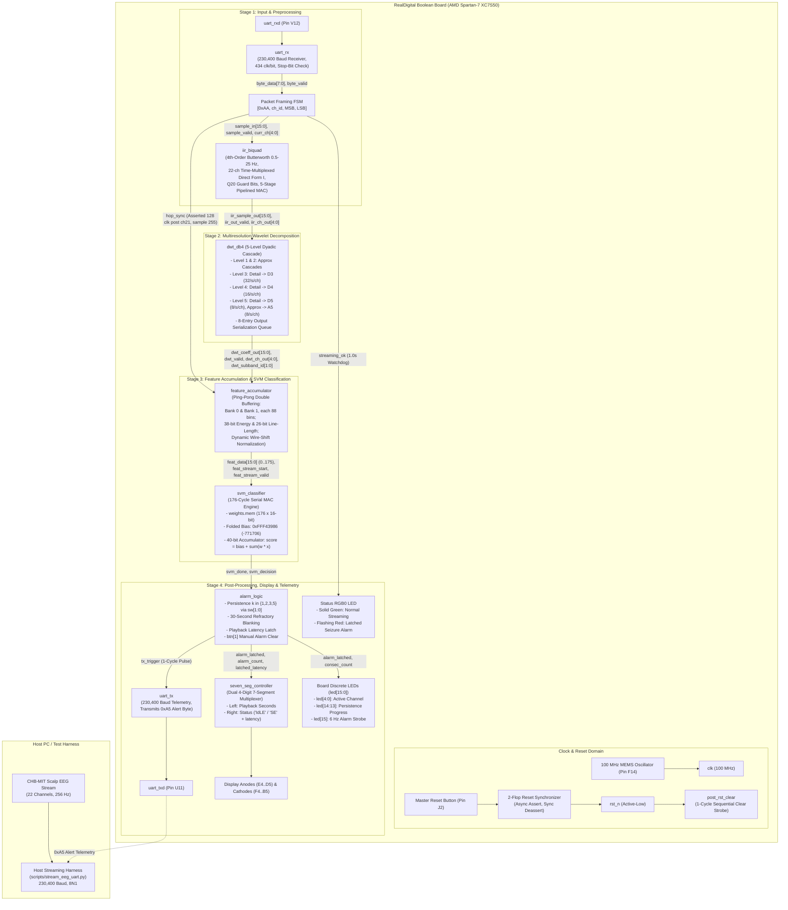

# Technical Audit: Hardware & System Architecture
**Project:** FPGA-Based Real-Time Multichannel EEG Seizure Detection  
**Target Hardware:** RealDigital Boolean Board (AMD Spartan-7 `xc7s50csga324-1`)  
**Audit Date:** November 2026  

---

## 1. High-Level Architecture & End-to-End Block Diagram

The complete hardware architecture processes a 22-channel continuous EEG stream over a single 100.0 MHz system clock domain. Because EEG sample frames arrive once every $\approx 3.906$ ms ($f_s = 256$ Hz), there are 390,625 clock cycles between consecutive time steps. The design exploits this massive throughput slack by utilizing a **time-multiplexed, single-pipeline datapath** with per-channel state stored in RAM, rather than replicating 22 distinct hardware processing engines.

### System Architecture Block Diagram



---

## 2. Reconstructed Subsystem Architecture

### 2.1 EEG Input & Packet Framing Interface
* **Source Files:** `rtl/uart_rx.v`, `rtl/top_seizure_detector.v` (Lines 82–215).
* **UART Configuration:** 230,400 baud, 8 data bits, no parity, 1 stop bit (8N1).
  - Bit period divisor: $100{,}000{,}000 / 230{,}400 \approx 434.027 \implies 434$ clock cycles per bit.
  - Mid-bit sampling: Sampled at cycle 217 (`HALF_BIT`) to verify start-bit validity and reject line glitches $< 2.17\,\mu\text{s}$.
  - Stop-bit verification: Sampled at cycle 433 (`CLKS_PER_BIT - 1`). If `rxd_sync2 == 1'b0`, a framing error pulse (`frame_err`) is emitted, invalidating the byte.
* **Packet Protocol:** 4 bytes per sample frame:
  $$\text{Byte 0: } \mathtt{0xAA} \;\text{(Sync Header)} \quad\longrightarrow\quad \text{Byte 1: } \text{Channel ID } (0 \le \text{ch} \le 21) \quad\longrightarrow\quad \text{Byte 2: } \text{MSB} \quad\longrightarrow\quad \text{Byte 3: } \text{LSB}$$
  Samples are 16-bit signed two's complement ($Q1.15$), big-endian format.
* **Packet Framing FSM (`top_seizure_detector.v`):**
  - Four states: `PKT_SYNC` (0), `PKT_CHAN` (1), `PKT_MSB` (2), `PKT_LSB` (3).
  - **Resynchronization Heuristic:** If `byte_data == 0xAA` arrives while in `PKT_CHAN`, the FSM assumes the previous packet was truncated and transitions immediately to `PKT_CHAN` to evaluate the next byte as a channel ID, preventing a 2-packet cascade drop.
  - **Pacing & Window Framing:** Increments `ch_sample_counter` (0..255) upon receiving channel 21. When `ch_sample_counter == 255`, one full 1.0-second window (256 samples $\times$ 22 channels = 5,632 samples) is complete.
  - **Pipeline Flush Timer:** A 128-cycle counter (`hop_drain_cnt`) is started upon the 256th frame. When it reaches 128, `hop_sync` is pulsed for 1 clock cycle to trigger ping-pong bank swapping in the feature accumulator, guaranteeing all in-flight DWT samples have cleared.

---

### 2.2 Front-End Digital Filtering (`iir_biquad.v`)
* **Source File:** `rtl/iir_biquad.v` (257 lines).
* **Mathematical Function:** 4th-order causal Butterworth bandpass filter spanning 0.5 Hz to 25.0 Hz at $f_s = 256$ Hz.
* **Topology:** Cascade of two 2nd-order Direct Form I (DF1) biquad sections:
  - **Section 0 (Lowpass Pair):**
    $$b_0 = [65688, \; 131377, \; 65688], \quad a_0 = [1048576, \; -1240423, \; 457209]$$
  - **Section 1 (Highpass Pair):**
    $$b_1 = [1048576, \; -2097152, \; 1048576], \quad a_1 = [1048576, \; -2078976, \; 1030563]$$
  - Scale factor: $2^{20} = 1{,}048{,}576$ ($\text{COEFF\_SHIFT} = 20$).
* **Per-Channel State Storage:**
  - 8 memory arrays of depth 22 (one entry per channel):
    `s0_mem_x1`, `s0_mem_x2` (16-bit), `s0_mem_y1`, `s0_mem_y2` (34-bit).
    `s1_mem_x1`, `s1_mem_x2` (16-bit), `s1_mem_y1`, `s1_mem_y2` (34-bit).
  - State width is 34 bits: 14 integer bits + 20 fractional guard bits, preventing truncation accumulation and limit cycles near the 0.5 Hz pole ($z \approx 0.9828$).
* **Pipelined Execution Datapath:**
  - State `S_IDLE` (0): Latches incoming sample and reads channel state from RAM.
  - State `S_SEC0_A` (1): Computes Section 0 feedforward sum (`ff0_sum_reg`, 48-bit) and feedback product (`fb0_prod_reg`, 60-bit).
  - State `S_SEC0_B` (2): Computes Section 0 subtraction, rounds with $+2^{19}$ (`524288`), saturates to 16 bits (`reg_y0_sat`), and stores unrounded 34-bit accumulator in `reg_acc0`.
  - State `S_SEC1_A` (3): Computes Section 1 feedforward sum (`ff1_sum_reg`) and feedback product (`fb1_prod_reg`).
  - State `S_SEC1_B` (4): Computes Section 1 subtraction, rounds with $+2^{19}$, saturates to 16 bits (`reg_y1_sat`), and stores 34-bit accumulator in `reg_acc1`.
  - State `S_WRITE` (5): Writes updated state back to RAM, asserts `out_valid`, and drives `sample_out`.

---

### 2.3 Discrete Wavelet Transform (`dwt_db4.v` & `dwt_level.v`)
* **Source Files:** `rtl/dwt_db4.v` (233 lines), `rtl/dwt_level.v` (195 lines).
* **Wavelet Basis:** Daubechies-4 (db4), 8-tap orthonormal decomposition filters:
  - Lowpass decomposition ($H$, `dec_lo`): `[-347, 1078, 1011, -6129, -917, 20673, 23424, 7549]` (scaled by $2^{15} = 32768$).
  - Highpass decomposition ($G$, `dec_hi`): `[7549, -23424, 20673, 917, -6129, -1011, 1078, 347]` (scaled by $2^{15} = 32768$).
* **Dyadic Multiresolution Structure:**
  - Level 1: $f_s = 256$ Hz $\to$ Approx (0–64 Hz) feeds Level 2; Detail (64–128 Hz) is dropped.
  - Level 2: $f_s = 128$ Hz $\to$ Approx (0–32 Hz) feeds Level 3; Detail (32–64 Hz, D2) is dropped in baseline.
  - Level 3: $f_s = 64$ Hz $\to$ Approx feeds Level 4; Detail (16–32 Hz) $\implies$ **Subband D3 (32 coeffs/s/ch)**.
  - Level 4: $f_s = 32$ Hz $\to$ Approx feeds Level 5; Detail (8–16 Hz) $\implies$ **Subband D4 (16 coeffs/s/ch)**.
  - Level 5: $f_s = 16$ Hz $\to$ Detail (4–8 Hz) $\implies$ **Subband D5 (8 coeffs/s/ch)**; Approx (0–4 Hz) $\implies$ **Subband A5 (8 coeffs/s/ch)**.
* **Internal Architecture of `dwt_level.v`:**
  - Optimized 8-cycle serial MAC architecture utilizing exactly 2 DSP48E1 slices per level (one for $H$, one for $G$).
  - Per-channel decimation phase register (`phase_ram[21:0]`). Toggles on every sample for that specific channel. Computation executes only when `phase_ram[ch_in] == 1'b1`.
  - Shift register history: `hist[0:21][0:6]` maintains the 7 previous samples per channel.
  - Saturation and Rounding: Accumulators are 36-bit. Rounding adds $+16384$ before arithmetic right shift by 15 (`>>> 15`). Saturation clamps values to $[-32768, 32767]$.
* **Output Queue & Collision Avoidance (`dwt_db4.v`):**
  - Because Levels 3, 4, and 5 produce outputs asynchronously based on channel decimation phases, an 8-entry FIFO queue (`queue_mem`) buffers results.
  - Each entry is 23 bits: `{subband_id[1:0], channel_id[4:0], coeff[15:0]}`.
  - Popping operates continuously whenever `q_count > 0`, generating clean 1-cycle pulses with one-hot flags `valid_d3`, `valid_d4`, `valid_d5`, `valid_a5`.

---

### 2.4 Feature Extraction Engine (`feature_accumulator.v`)
* **Source File:** `rtl/feature_accumulator.v` (394 lines).
* **Feature Set:** Sub-band Energy ($E$) and Line-Length ($LL$) across 22 channels and 4 subbands $\implies 22 \times 4 \times 2 = 176$ features.
* **Double-Buffering Architecture:**
  - Two symmetric RAM banks: Bank 0 and Bank 1, each 88 entries deep ($22 \times 4$).
  - Controlled by single write-port multiplexing targeting Distributed LUTRAM inference (`(* ram_style = "distributed" *)`).
  - Active Bank (`active_buf`): Accumulates squared coefficients ($c^2$) into 38-bit energy accumulators and absolute differences ($|c_i - c_{i-1}|$) into 26-bit line-length accumulators.
  - Stream Bank (`stream_buf`): Sequentially read out and zeroed on-the-fly over 176 clock cycles following `window_sync`.
* **Hardware Dynamic Wire-Shift Normalization:**
  To eliminate hardware divider circuits, normalization divides by $N_b$ (Energy) or $N_b - 1$ (Line-Length) via bit shifts and round-to-nearest additions:
  
  | Subband | Samples/Window ($N_b$) | Energy Shift & Rounding | Line-Length Shift & Rounding |
  |---|---|---|---|
  | **D3** | 32 ($N_b - 1 = 31$) | `(acc + 524288) >>> 20` | `(acc + 16) >>> 5` |
  | **D4** | 16 ($N_b - 1 = 15$) | `(acc + 262144) >>> 19` | `(acc + 8) >>> 4` |
  | **D5** | 8 ($N_b - 1 = 7$) | `(acc + 131072) >>> 18` | `(acc + 4) >>> 3` |
  | **A5** | 8 ($N_b - 1 = 7$) | `(acc + 131072) >>> 18` | `(acc + 4) >>> 3` |

  Normalized outputs are clamped to $[0, 32767]$ in signed 16-bit format.

---

### 2.5 Linear SVM Inference Engine (`svm_classifier.v`)
* **Source File:** `rtl/svm_classifier.v` (75 lines).
* **Mathematical Function:**
  $$\text{Score} = b_{\text{fixed}} + \sum_{j=0}^{175} \left( w_{\text{fixed}}[j] \times \text{feat}[j] \right), \qquad \text{Decision} = (\text{Score} > 0) \;\; ? \;\; 1 \;\; : \;\; 0$$
* **Offline Parameter Folding:**
  Floating-point standardization ($\mu, \sigma$) and hardware scale factors ($K_{\text{feat}}, S_M$) are folded offline:
  $$w_{\text{eff}} = \frac{w_{\text{float}}}{\sigma}, \quad b_{\text{eff}} = b_{\text{float}} - \sum_{j=0}^{175} \frac{w_{\text{float}}[j] \cdot \mu[j]}{\sigma[j]}$$
  The integer weights are scaled by $S_M = 1500$ to fit into 16-bit signed integers ($w_{\text{fixed}} \in [-32768, 32767]$). The bias is scaled into a 32-bit signed integer ($b_{\text{fixed}} = \mathtt{0xFFF43986} = -771{,}706$).
* **Datapath Execution:**
  - Evaluates in 176 consecutive clock cycles ($1.76\,\mu\text{s}$ at 100 MHz).
  - Uses 1 DSP48E1 multiplier slice ($16 \times 16 \to 32$ bits signed).
  - Accumulator is 40 bits wide, providing 8 guard bits against overflow ($176 \times 2^{30} \approx 2^{37.5} < 2^{39}$).
  - Outputs a clean 1-cycle `done` strobe, registered `decision`, and 40-bit `score`.

---

### 2.6 Alarm Post-Processing, Refractory & Telemetry (`alarm_logic.v` & `uart_tx.v`)
* **Source Files:** `rtl/alarm_logic.v` (111 lines), `rtl/uart_tx.v` (65 lines).
* **Persistence Filter ($k$-consecutive):**
  - Requires $k$ consecutive positive window classifications before asserting the alarm.
  - Switch selectable via `sw[1:0]`: `00` $\to k=1$, `01` $\to k=2$, `10` $\to k=3$ (default baseline), `11` $\to k=5$.
  - Any background decision (`svm_decision == 0`) immediately resets `consec_count` to 0.
* **30-Second Refractory Blanking:**
  - When an alarm asserts, `refractory_timer` is loaded with $30$ seconds.
  - Ticked downward on each 1.0-second `sec_tick` (`hop_sync`). While `refractory_timer > 0`, new alarm triggers are suppressed to prevent duplicate event counting during an extended seizure.
* **Manual Alarm Clear:**
  - Monitored on button `btn[1]`. Synchronized via a 2-flop synchronizer (`btn1_sync`) and edge-detected (`btn_rise`).
  - Clears `alarm_latched` and resets `consec_count`, but deliberately preserves `refractory_timer` to prevent immediate re-triggering.
* **Telemetry Output (`uart_tx.v`):**
  - Pulses `tx_trigger` upon alarm assertion.
  - `uart_tx.v` serializes byte `0xA5` at 230,400 baud.
  - Line idle state is strictly Idle-High (`1'b1`), eliminating UART line break faults.

---

### 2.7 Board Display & Visual Status Controllers
* **Source Files:** `rtl/seven_seg_controller.v` (166 lines), `rtl/top_seizure_detector.v` (Lines 393–456).
* **Dual 4-Digit 7-Segment Display:**
  - Multiplexed at 1.0 kHz ($100{,}000{,}000 / 100{,}000$ cycles), giving 125 Hz per digit refresh.
  - Display 1 (Left 4 Digits, Anodes 7..4): Displays elapsed streaming time in seconds ($0..9999$).
  - Display 0 (Right 4 Digits, Anodes 3..0):
    - Normal state: Displays `IdLE` (Segments: `I` on digit 3, `d` on digit 2, `L` on digit 1, `E` on digit 0).
    - Alarm state: Displays `SE` followed by the 2-digit latched latency in seconds (e.g., `SE03`).
* **Discrete LEDs:**
  - `led[4:0]`: Real-time index of the currently active EEG channel ($0..21$).
  - `led[13]`: Illuminates when consecutive positive count $\ge 1$.
  - `led[14]`: Illuminates when consecutive positive count $\ge 2$.
  - `led[15]`: 6.0 Hz alarm strobe (`strobe_cnt[23]`), active only when `seizure_alarm_latched == 1'b1`.
* **RGB Status LED 0:**
  - 1.0-second re-triggerable watchdog timer (`stream_watchdog`).
  - When streaming is active and no alarm is latched: `rgb0_g` is Solid Green.
  - When a seizure alarm is latched: `rgb0_r` flashes red synchronously with `alarm_strobe` (6 Hz); `rgb0_g` is extinguished.

---

## 3. Clocking, Reset & Metastability Protection

1. **System Clock:** Single synchronous 100.000 MHz clock domain driven by onboard MEMS oscillator pin `F14`. There are no clock dividers, gated clocks, or multi-clock domain crossings in the RTL.
2. **Reset Synchronizer:**
   - Pushbutton `rst` (`btn[0]`, Pin J2) is asynchronous and active-high.
   - `top_seizure_detector.v` (lines 50–57) implements a dedicated 2-flop reset synchronizer:
     ```verilog
     always @(posedge clk or posedge rst) begin
         if (rst) rst_sync <= 2'b00;
         else     rst_sync <= {rst_sync[0], 1'b1};
     end
     wire rst_n = rst_sync[1];
     ```
   - Asserts asynchronously to immediately place all registers in a known state; deasserts synchronously with the rising edge of `clk`, eliminating reset recovery/removal timing violations.
3. **Button Synchronizer:**
   - Pushbutton `btn[1]` (Alarm Clear) is synchronized through a 2-flop shift register (`btn1_sync`) before driving edge detection logic.
4. **UART RX Input:**
   - Serial pin `uart_rxd` is synchronized through a 2-flop synchronizer (`rxd_sync1`, `rxd_sync2`) in `uart_rx.v`.
